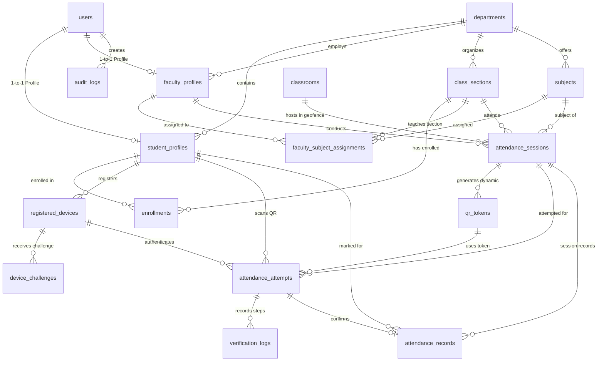

# Database Entity-Relationship (ER) Diagram

### Table Relationships & Key Constraints:
1. **users**: Primary authentication credentials (`user_id`, `username`, `email`, `role`, `password_hash`).
2. **student_profiles** & **faculty_profiles**: Extended profile entities linked via foreign key to `users(user_id)`.
3. **classrooms**: Stores high-precision GPS decimal coordinates (`latitude`, `longitude`) and configurable `allowed_radius_meters`.
4. **qr_tokens**: Holds SHA-256 hashes of temporary 256-bit entropy tokens (`token_hash`, `issued_at`, `expires_at`, `token_status`).
5. **attendance_attempts**: Tracks two-step reservations (`request_id`, `scan_time`, `reservation_expires_at`, `verification_status`).
6. **attendance_records**: Contains verified records guarded by `UNIQUE(student_id, session_id)` ensuring no duplicate attendance is ever recorded.
7. **verification_logs**: Audit logs of each individual check (QR validity, enrollment, GPS geofence distance, ECDSA device challenge signature).

